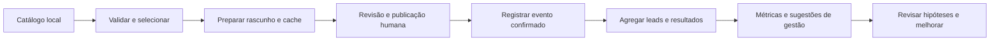

# Agente de Marketing para Marketplace

[](https://github.com/Pedronsjaja/marketplace-marketing-agent/actions/workflows/tests.yml)

Framework Python que prioriza dados locais para **marketing assistido em marketplaces**: prepara rascunhos com informações verificadas, registra eventos confirmados, calcula métricas agregadas e indica quando um modelo de IA poderia ser apropriado.

O projeto foi inspirado por um fluxo operacional privado, mas possui implementação independente e exemplos inteiramente fictícios. Não inclui dados de clientes, anúncios operacionais, imagens, credenciais ou sessões de navegador.

## Estado desta versão

Esta página descreve o código da branch `main`. A atualização operacional **V3**, com feedback da plataforma, quarentena de duplicados e preparação de pacotes, foi desenvolvida separadamente no ambiente privado e **ainda não foi incorporada ao código deste repositório**. A publicação automática pelo navegador permanece sem validação de ponta a ponta.

<a id="scope"></a>
## Escopo

| Componente | Estado | O que faz |
|---|---|---|
| Agente Marketplace | IMPLEMENTADO | PREPARE, registro local de eventos confirmados e ANALYZE |
| Validação de produtos e cache de rascunhos | IMPLEMENTADO | Valida entradas, identifica revisões de fonte/política/template e evita preparação repetida |
| Máquina de estados e controle de duplicação | IMPLEMENTADO | Transições válidas, IDs de catálogo e URLs de anúncios únicos, eventos seguros para repetição |
| Base do gerente de marketing | IMPLEMENTADO | Fatos determinísticos, prioridade para resultados pendentes e sugestões identificadas |
| Roteador de modelos | IMPLEMENTADO | Política de seleção de nível; não chama modelos de linguagem |
| Interfaces de canais e provedores | IMPLEMENTADO | Contratos Python Protocol e adaptador manual de rascunhos |
| Publicação automática e coleta/encaminhamento de leads | PLANEJADO | Sem API de plataforma ou automação de navegador nesta versão |
| Adaptadores de modelos, inferência local e agente de estratégia | PLANEJADO | Sem download de modelos, instalação de SDKs ou chamadas pagas |
| Execução de benchmarks de modelos | PLANEJADO | Apenas tarefas, critérios e modelos de resultado com campos ainda não preenchidos |

A redução de tokens e custos é um objetivo de projeto; ainda não é um resultado medido. O código disponível não constitui um agente de vendas totalmente autônomo.

<a id="workflow"></a>
## Fluxo de trabalho



As ações externas acontecem fora da CLI e precisam ser confirmadas antes do registro. O programa não publica anúncios, contata leads, envia mensagens, verifica vendas reais ou contorna controles das plataformas.

<a id="run-locally"></a>
## Executar localmente

Requer Python 3.10 ou superior. Execução e testes usam a biblioteca padrão. Na raiz do repositório:

```text
python scripts/marketplace.py prepare
python scripts/marketplace.py prepare
python scripts/marketplace.py metrics --control data/control.sample.csv
python scripts/marketplace.py analyze --control data/control.sample.csv
python scripts/marketplace.py route metrics
python scripts/marketplace.py route copy
python -m unittest discover -s tests -v
python scripts/validation/audit_public.py
```

A primeira preparação salva três rascunhos fictícios em `workspace/state.json`, ignorado pelo Git. A segunda retorna `CACHE_HIT`. As métricas de exemplo contêm 12 leads, 8 encaminhados e 2 convertidos; `sales_per_lead` corresponde a 2/12. Sem provedor configurado, `route copy` retorna nível `null` e solicita revisão humana/configuração.

Consulte o [exemplo completo](docs/marketplace-example.md) para confirmação, idempotência, execução parcial, exportações e resultados. Códigos de saída: 0 indica sucesso; 1 indica preparação com erros em alguns itens; 2 indica entrada inválida ou falha de execução. Confira o JSON retornado para saber quais itens tiveram sucesso.

<a id="design"></a>
## Organização

- **Agente Marketplace:** estado e operações locais explícitos; conflitos secundários de política são informados enquanto a preparação permitida continua.
- **Gerente de marketing:** distingue FATO, HIPOTESE e RECOMENDACAO. A base implementada usa contagens registradas, sem LLM ou inferência causal.
- **Roteador de modelos:** nível 0 determinístico → nível 1 local/econômico → nível 2 nuvem econômica → nível 3 premium. Nuvem e premium exigem permissões explícitas distintas; novas tentativas e escalonamento não são automáticos.
- **Armazenamento:** transações JSON locais, bloqueio exclusivo de escrita, substituição atômica e intercâmbio por CSV.
- **Canais e provedores:** interfaces isoladas; regras de plataforma e SDKs de modelos ficam fora do núcleo do domínio.

Consulte [arquitetura](docs/architecture.md), [desenho dos agentes](docs/agent-design.md), [workflow](docs/workflow.md), [modelo de dados](docs/data-model.md) e [roteamento de modelos](docs/model-routing.md). Alguns documentos complementares ainda estão em inglês; gestão e marketing adotam português como idioma principal.

<a id="configure-and-extend"></a>
## Configurar e ampliar

Copie `config/config.example.json` para um arquivo local ignorado pelo Git e informe `--config` antes do subcomando. Solicitações operacionais não reescrevem a política. Os provedores estão desativados: `config/providers.example.json` documenta a configuração pretendida, mas não é carregado por esta versão.

Para adicionar um modelo, implemente `Provider.generate` e trate explicitamente credenciais, limites, tentativas, uso e consentimento; consulte [model-routing.md](docs/model-routing.md). Para adicionar um canal, implemente `Channel.draft`, injete-o em `MarketplaceAgent` e valide suas capacidades; consulte [architecture.md](docs/architecture.md). Evite adaptadores vazios que anunciem integrações inexistentes.

<a id="safety-evidence-and-contribution"></a>
## Segurança, evidências e contribuição

Todas as métricas de exemplo são `FICTIONAL` ou `CALCULATED_FROM_FICTIONAL`. O campo de verificação registra uma afirmação do operador, sem constituir checagem independente. As contagens são agregadas; leads individuais não são armazenados.

Leia [segurança](docs/security.md), [orientações de contribuição](CONTRIBUTING.md), [roadmap](ROADMAP.md), [validação](docs/validation.md) e [créditos de terceiros](THIRD_PARTY_CREDITS.md). O código usa licença MIT; material operacional privado não foi importado.
