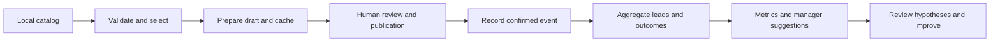

# Marketplace Marketing Agent

[](https://github.com/Pedronsjaja/marketplace-marketing-agent/actions/workflows/tests.yml)

A local-first Python framework for **assisted marketplace marketing**: prepare verified product drafts, track confirmed workflow events, calculate aggregate metrics, and decide when a future model would be appropriate.

The initial design was informed by a private marketplace workflow. This repository is a new, independent implementation with entirely fictional examples. It includes no customer data, operational advertisements, images, credentials or browser sessions.

## Scope

| Component | Status | What it actually does |
|---|---|---|
| Marketplace Agent | IMPLEMENTED | PREPARE, local confirmed event recording and ANALYZE |
| Product validation / draft cache | IMPLEMENTED | Validates inputs, fingerprints source/policy/template, avoids repeated preparation |
| State machine / duplicate control | IMPLEMENTED | Valid transitions, unique catalog IDs/listing URLs and retry-safe event IDs |
| Marketing Manager baseline | IMPLEMENTED | Deterministic facts, outstanding-outcome priority and labeled suggestions |
| Model Router | IMPLEMENTED | Pure level-selection policy; does not call an LLM |
| Provider/channel interfaces | IMPLEMENTED | Python Protocol contracts and a manual draft adapter |
| Automatic publication, lead fetching or forwarding | PLANNED | No platform API or browser automation |
| Model adapters, local inference, strategy agent | PLANNED | No models downloaded, SDKs installed or paid calls |
| Model benchmark execution | PLANNED | Shared task/rubric and nullable result templates only |

No fully autonomous sales agent or proprietary model is claimed. Token/cost reduction is a design objective, not a measured result.

## Workflow



The program cannot publish, contact leads, send messages, verify actual sales or bypass platform controls. External actions happen outside the CLI and must be confirmed before they are recorded.

## Run locally

Python 3.10+; runtime and tests use the standard library. From the repository root:

```text
python scripts/marketplace.py prepare
python scripts/marketplace.py prepare
python scripts/marketplace.py metrics --control data/control.sample.csv
python scripts/marketplace.py analyze --control data/control.sample.csv
python scripts/marketplace.py route metrics
python scripts/marketplace.py route copy
python -m unittest discover -s tests -v
python scripts/validation/audit_public.py
```

The first preparation stores three fictional drafts in ignored workspace/state.json. The second returns CACHE_HIT. The sample metrics contain 12 leads, 8 forwarded leads and 2 converted leads; sales_per_lead is 2/12. Without a provider, route copy returns level null and asks for human review/configuration.

Use [the worked example](docs/marketplace-example.md) for confirmation, idempotency, partial success, exports and outcomes. Exit codes: 0 success; 1 PREPARE completed with some item errors; 2 invalid command data or execution failure. Review the JSON result instead of assuming every item succeeded.

## Design

- **Marketplace Agent:** explicit local state and operations; a secondary policy conflict is reported while valid preparation continues.
- **Marketing Manager:** separates FATO, HIPOTESE and RECOMENDACAO. The implemented baseline uses recorded counts, not an LLM or causal inference.
- **Model Router:** level 0 deterministic → level 1 local/inexpensive → level 2 economical cloud → level 3 premium. Cloud and premium require separate explicit permissions; retries/escalation are not automatic.
- **Storage:** local JSON transactions, exclusive writer lock, atomic replacement and CSV interchange.
- **Channels/providers:** isolated interfaces; platform rules and model SDKs do not belong in the domain core.

See [architecture](docs/architecture.md), [agent design](docs/agent-design.md), [workflow](docs/workflow.md), [data model](docs/data-model.md) and [model routing](docs/model-routing.md).

## Configure and extend

Copy config/config.example.json to an ignored local config file and pass --config before the subcommand. Runtime requests never rewrite policy. Providers are currently disabled: config/providers.example.json documents the intended configuration, but is not loaded by this version.

To add a model, implement Provider.generate and explicitly handle credentials, limits, retries, usage and consent; follow [model-routing.md](docs/model-routing.md). To add a channel, implement Channel.draft, inject it into MarketplaceAgent and validate capabilities; see [architecture.md](docs/architecture.md). Do not add empty adapters claiming integrations that do not exist.

## Safety, evidence and contribution

All sample metrics are FICTIONAL or CALCULATED_FROM_FICTIONAL. A verified flag records an operator assertion, not independent fact checking. Counts are aggregate; no individual leads are stored.

Read [security](docs/security.md), [contribution guidance](CONTRIBUTING.md), [roadmap](ROADMAP.md), [validation](docs/validation.md) and [third-party credits](THIRD_PARTY_CREDITS.md). The code is MIT licensed; private operational material was not imported.
